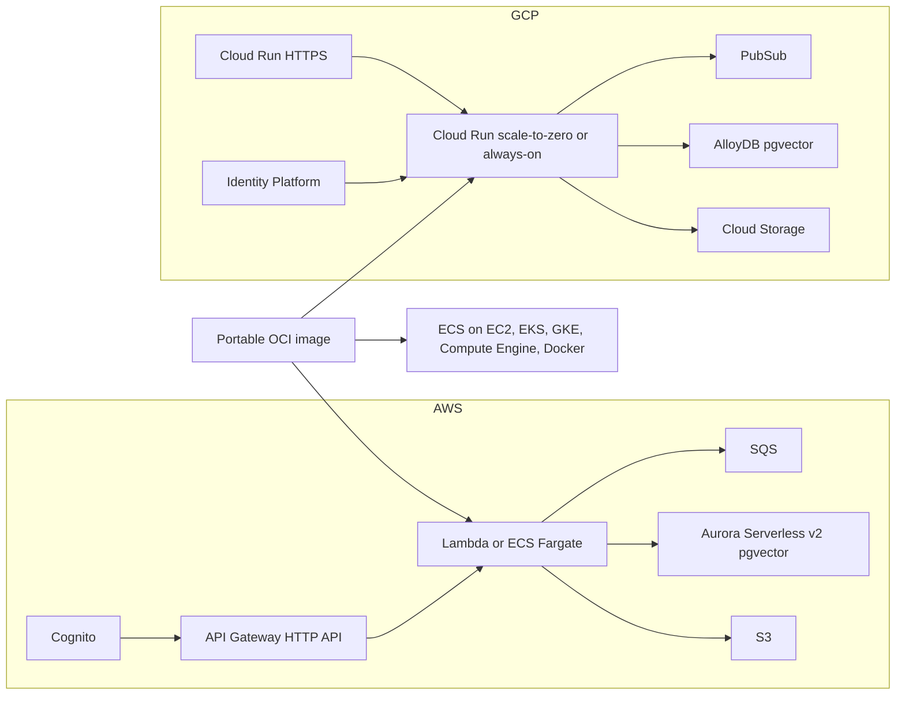

# ForgeArc AI Production Deployment (AWS and GCP)

## Architecture

The same application image and the same repository contract run on both clouds. Each cloud offers a serverless mode and an always-on container mode, and both modes share durable storage.

Runtime choices:

- AWS: `runtime=lambda|fargate` in CDK context. Lambda scales to zero; Fargate is always on.
- GCP: `runtime_mode=serverless|always_on` in Terraform. Serverless is Cloud Run with `min_instance_count = 0`. Always-on is Cloud Run with minimum instances and CPU always allocated, which gives the same continuously running behaviour as Fargate without cluster management.
- Portable image: documented for ECS on EC2, EKS, GKE, Compute Engine, and plain Docker. No separate EC2, GKE, or Compute Engine stacks are provisioned.

Always-on reduces cold-start latency. It does not replace durable state, because containers still restart, redeploy, and scale out. Every mode requires the database.

## Durable repository layer

- Define an application repository protocol under [`products/forgearc-ai/packages/core/src/forgearc_ai/repositories/`](products/forgearc-ai/packages/core/src/forgearc_ai/repositories/) and refactor services away from direct dictionary and list mutation.
- Keep `MemoryRepository` for local and tests. Add a SQLAlchemy `PostgresRepository` selected by `database_url`, covering documents, chunks, jobs, conversations, usage, audits, agent runs, approvals, and evaluations.
- Persist complete, versioned agent graph state in `agent_runs.state_json`. Make approval decisions transactional and idempotent with row locking and version checks so concurrent reviewers cannot run a tool twice.
- Extend [`products/forgearc-ai/packages/core/src/forgearc_ai/models.py`](products/forgearc-ai/packages/core/src/forgearc_ai/models.py) and Alembic migrations with constraints, indexes, run-state versions, approval uniqueness, and pgvector tenant-scoped retrieval.
- Update [`products/forgearc-ai/apps/api/src/forgearc_ai_api/wiring.py`](products/forgearc-ai/apps/api/src/forgearc_ai_api/wiring.py) to allow memory only in local and test, and fail production startup without PostgreSQL. The same code path serves Aurora and AlloyDB.

## Portable container runtime

- Add a multi-stage, non-root Dockerfile with `api` (uvicorn) and `worker` commands. The worker long-polls SQS on AWS; on GCP it keeps receiving authenticated Pub/Sub push at `/internal/pubsub`.
- Add health and readiness endpoints, graceful shutdown, bounded concurrency, and no credentials baked into the image.
- Expand [`products/forgearc-ai/docker-compose.yml`](products/forgearc-ai/docker-compose.yml) to run Postgres/pgvector, migrations, API, and worker locally in the production image shape.
- Run migrations as a one-off job before rollout: an ECS task on AWS and a Cloud Run Job on GCP. API replicas never migrate on startup.
- Update CI and release packaging to build, scan, and smoke-test the image.

## AWS: Lambda and Fargate

- Refactor [`products/forgearc-ai/infra/cdk/stacks/ai_stack.py`](products/forgearc-ai/infra/cdk/stacks/ai_stack.py) into shared data and security constructs plus selectable Lambda and Fargate runtime constructs.
- Provision a VPC with private workloads, Aurora Serverless v2 PostgreSQL/pgvector, RDS Proxy, Secrets Manager credentials with rotation, KMS encryption, backups, and production deletion protection.
- Fargate: private API and worker services behind API Gateway HTTP API through VPC Link and an internal load balancer, queue-depth worker scaling, CPU and request API scaling, deployment circuit breaker, read-only filesystem, dropped Linux capabilities, and least-privilege task roles.
- Lambda: replace the stub asset handlers in [`products/forgearc-ai/infra/cdk/assets/handler.py`](products/forgearc-ai/infra/cdk/assets/handler.py) with the real FastAPI/Mangum API and SQS worker, attached to the VPC and RDS Proxy.
- Alarms for DLQ depth, 5xx, latency, unhealthy tasks, database connections and capacity, and budget.

## GCP: Cloud Run serverless and always-on

- Update [`products/forgearc-ai/infra/terraform/main.tf`](products/forgearc-ai/infra/terraform/main.tf) and [`products/forgearc-ai/infra/terraform/variables.tf`](products/forgearc-ai/infra/terraform/variables.tf) with `runtime_mode`, min and max instances, concurrency, CPU allocation, and health probes for the API and worker.
- Make AlloyDB mandatory when `environment = "prod"`, connected over Direct VPC egress. Store the connection string in Secret Manager and inject `DATABASE_URL`; enable AlloyDB backups.
- Set the worker service ingress to internal. Pub/Sub push keeps OIDC authentication, and only the Pub/Sub identity gets `run.invoker` on the worker.
- Add a Cloud Run Job for migrations, CMEK options for Storage, Pub/Sub, and Secret Manager, and Cloud Monitoring alerts for dead-letter messages, 5xx, latency, instance count, and database connections.
- Keep Firestore for job status, as today.

## Identity and production security (both clouds)

- Extend [`products/forgearc-ai/packages/core/src/forgearc_ai/auth.py`](products/forgearc-ai/packages/core/src/forgearc_ai/auth.py) and configuration with OIDC/JWKS verification (`auth.mode: local|oidc`, issuer, audience, JWKS URL, claim mapping). HMAC local tokens stay available outside production only.
- AWS: provision a Cognito user pool, app client, groups mapped to permissions, a tenant claim, and an API Gateway JWT authorizer.
- GCP: provision Identity Platform with the same claim mapping. The application verifies tokens against its JWKS on every request.
- The application re-checks issuer, audience, expiry, tenant, module, and permission on both clouds.
- HTTPS only, private workloads, KMS or CMEK encryption, blocked public storage, secret rotation, log redaction, request and upload size limits, strict CORS, and retained audit events.
- Production validation rejects local users, HMAC auth, memory repositories, permissive CORS, and missing identity or database settings.

## Documentation

- Add `apps/docs/ai/durable-state.md` as a durable architecture decision record explaining:
  - The observed problem: `MemoryRepository` keeps jobs, vectors, conversations, usage, agent runs, approvals, and evaluations inside one Python process.
  - The exact failure flow: an agent pauses for approval, Lambda or a container restarts/scales, the reviewer reaches another process, and the run or approval can no longer be found.
  - Why an always-on ECS, Fargate, EC2, Cloud Run, or Compute Engine process does not solve it: deployments, crashes, autoscaling, health replacement, and multiple replicas still destroy or split process memory.
  - Why PostgreSQL/pgvector was selected: it fits the existing SQLAlchemy/Alembic schema, stores transactional approval state and vector embeddings together, supports row locking and uniqueness for exactly-once approval decisions, and has managed equivalents on both clouds (Aurora and AlloyDB).
  - Alternatives considered and rejected: in-memory-only, sticky sessions, local disk/EFS, DynamoDB plus a separate vector database, and queue-only state reconstruction.
  - Runtime rules: memory is local/test only; production requires a database; every state access is tenant-scoped; approval updates are transactional and idempotent; secrets never enter state JSON.
  - Cost and operational trade-offs: database cost, backups, migrations, connection pooling, auto-pause/capacity settings, and recovery expectations.
  - A before/after sequence diagram showing the failed memory-only approval flow and the restart-safe database flow.
  - Acceptance evidence: restart/resume tests, concurrent-review tests, tenant-isolation tests, and backup/restore checks.
- Add a short link and summary titled “Why ForgeArc AI needs durable state” to the product README, `configuration.md`, `security.md`, and both cloud deployment guides so the rationale is discoverable during later review.
- New `apps/docs/ai/production.md`: choosing serverless or always-on on AWS and GCP, cost comparison, minimum production requirements, and why durable state is required in every mode.
- Update `deploy.md` (AWS Lambda and Fargate) and `deploy-gcp.md` (Cloud Run modes, AlloyDB, Identity Platform) with commands, migrations, rollback, backup and restore, secret rotation, scaling, and incident steps.
- Add a portable-image guide for ECS on EC2, EKS, GKE, Compute Engine, and Docker.
- Update `security.md`, `configuration.md`, `aws-architecture.md`, the architecture map component, the docs sidebar, and the product README.

## Website

- Home page: add a runtime section showing AWS Lambda or Fargate and GCP Cloud Run serverless or always-on, reusing the existing AWS/GCP cloud switch so both clouds show equivalent choices.
- Update [`apps/marketing/src/components/ArchitectureDiagram.vue`](apps/marketing/src/components/ArchitectureDiagram.vue) and [`apps/marketing/src/components/ArchitectureLayers.vue`](apps/marketing/src/components/ArchitectureLayers.vue) to show the runtime choice, Aurora or AlloyDB, and Cognito or Identity Platform.
- Cost dashboard image: run the API locally with seeded sample usage across chat, agent, supervisor, decision, and evaluation features plus a pending approval. Capture the real `/dashboard` page in the browser, save optimized WebP and PNG files under `apps/marketing/public/images/`, and show them in a new home page section with a clear "Sample data" label, descriptive alt text, lazy loading, and a responsive frame matching the copper and charcoal theme.
- Update the FAQ and product copy for runtime choice and production security. Pricing does not change.

## Verification

- Repository contract tests against memory and PostgreSQL, restart and resume approval tests, concurrent approval idempotency tests, tenant isolation, and JWT/JWKS tests for Cognito and Identity Platform claim shapes.
- Ruff, all Python tests, Alembic upgrade and downgrade, Docker build and API/worker smoke tests, CDK synth for `lambda` and `fargate`, `terraform validate` for both runtime modes, docs and marketing builds, a visual check of the new home page section, and the standalone release export.
