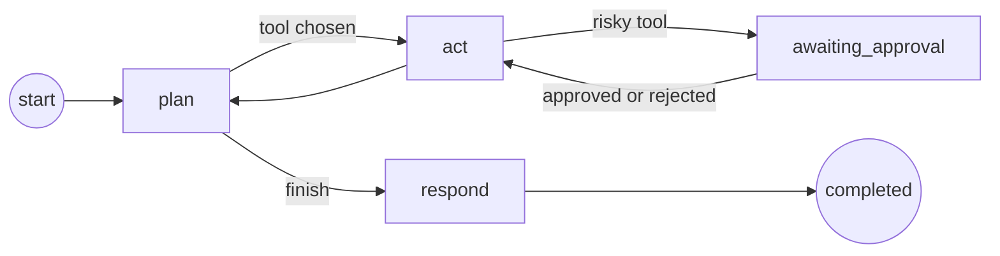

# Agents, approvals, and evaluation

These features ship in **ForgeArc AI Pro**. They run on the same model provider, policy gate, budget, and tenant store as chat, so they work unchanged with OpenAI, Bedrock, or Vertex AI.

## Tool-calling agents

`POST /api/agents/run` starts an agent. The agent plans with the model, calls one tool at a time, and answers from what the tools returned.

```json
{ "message": "How long do refunds take? Tell the billing team.", "tools": ["retrieve_documents", "notify_webhook"] }
```

Pass `"agent": "researcher"` to use a configured profile instead of a tool list. Each tool runs at most once per run, and `agents.max_steps` caps the number of tool calls.

| Tool | What it does | Needs approval |
| --- | --- | --- |
| `retrieve_documents` | Searches the tenant's documents and adds citations | No |
| `list_documents` | Lists the tenant's uploaded file names | No |
| `notify_webhook` | Sends a signed notification to the configured webhook | Yes |

The agent is a state graph with `plan`, `act`, and `respond` nodes. The built-in runner has no extra dependencies. With the `langgraph` extra installed, `AgentService.agent_graph.compile_langgraph()` compiles the same nodes into a LangGraph `StateGraph`.



## Human approval

A tool listed in `agents.approval_tools` never runs straight away. The run stops with `status: awaiting_approval` and a `pendingApproval` record.

1. A reviewer lists pending calls with `GET /api/approvals`.
2. The reviewer calls `POST /api/approvals/{approvalId}` with `{"decision": "approve"}` or `{"decision": "reject", "note": "..."}`.
3. The run resumes from the paused step. An approved call runs; a rejected call is recorded as an observation and never executes.

The reviewer needs the `ai:approve` permission and, by default, must be a different person from the one who started the run. Set `agents.allow_self_approval: true` only for single-operator setups. Every request and decision is written to the audit log without the prompt text.

## Multi-agent supervisor

`POST /api/agents/supervise` hands a request to a supervisor. The supervisor picks agents from `agents.profiles` one at a time, passes each one the request, and writes the final answer from their findings.

```json
{ "message": "Summarize the refund policy and notify billing.", "agents": ["researcher", "operator"] }
```

If a delegated agent needs approval, the supervisor run pauses too. Approving the tool call resumes the agent and then the supervisor. The supervisor's `usage` includes the tokens and cost of every agent it called.

## Evaluation

`POST /api/evaluations` scores a batch of question-and-answer samples with the RAGAS metric names:

| Metric | Native engine measures | Needs |
| --- | --- | --- |
| `faithfulness` | Share of answer sentences supported by the contexts | Answer and contexts |
| `answerRelevancy` | Embedding similarity between question and answer | Question and answer |
| `contextPrecision` | Rank-weighted share of relevant contexts | Contexts |
| `contextRecall` | Share of reference sentences found in the contexts | A `reference` |

Leave out `contexts` to retrieve them from the tenant's documents. Leave out `answer` to generate it with the configured model. That evaluates the live pipeline.

```json
{
  "samples": [{ "question": "How long do refunds take?", "reference": "Refunds are processed within five business days." }],
  "thresholds": { "faithfulness": 0.8 }
}
```

The response has per-sample scores, averages, `passed`, the failed thresholds, and a `ragasDataset` in RAGAS's own column format. Fail a CI job when `passed` is false.

The default `native` engine is deterministic, offline, and costs nothing beyond embeddings. It is a regression gate, not an LLM judge. Send `"engine": "ragas"` to score the same samples with the RAGAS library; that needs the `ragas` extra and the judge model credentials RAGAS expects.

## Cost dashboard

`GET /api/usage/dashboard?days=30` returns:

- Month-to-date spend, remaining budget, percent used, and projected month-end spend.
- Spend and tokens by model and by feature: `chat`, `decision`, `agent`, `supervisor`, and `evaluation`.
- A daily series for the chosen window.
- Agent run counts and how many are waiting for approval.

Open `/dashboard` on the API host for a built-in page that shows these figures and lets reviewers approve or reject pending tool calls.

## Configuration

Defaults work without YAML. Override only what you need:

```yaml
agents:
  max_steps: 4
  approval_tools: [notify_webhook]
  allow_self_approval: false
  profiles:
    researcher: { description: Finds and cites facts from documents., tools: [retrieve_documents, list_documents] }
    operator: { description: Sends notifications after approval., tools: [notify_webhook] }
evaluation:
  thresholds: { faithfulness: 0.7, answerRelevancy: 0.5 }
```

Every profile tool must also appear in `tool_allowlist`; startup fails otherwise.

## Optional extras

```bash
uv sync --all-packages --extra langgraph --extra ragas
```

Neither extra is required to run agents, approvals, the supervisor, native evaluation, or the dashboard.
