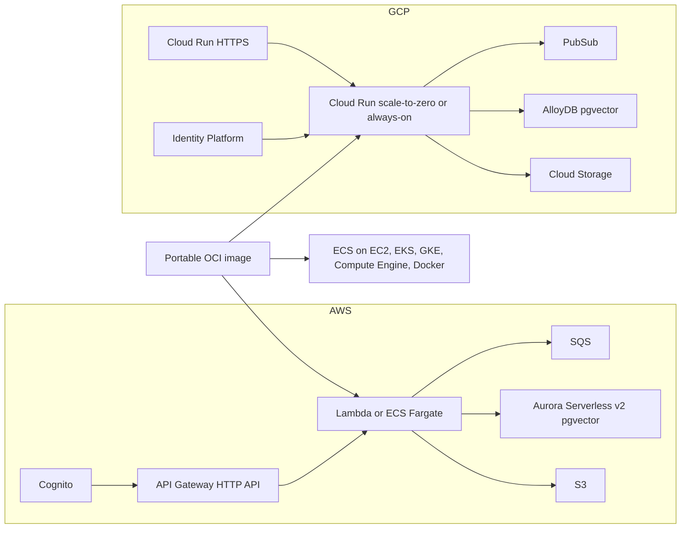

# ForgeArc AI production implementation summary

This page records everything delivered for the **AI Production Runtimes** plan: durable PostgreSQL/pgvector state, selectable serverless and always-on runtimes on AWS and GCP, a portable hardened container, OIDC identity, documentation, website updates, and validation.

It is a review artifact for later. Operator how-tos remain in [Durable state](./durable-state), [Production runtimes](./production), [Portable container](./container), [AWS deployment](./deploy), and [GCP deployment](./deploy-gcp).

## Plan outcomes

| Plan todo | Status | What shipped |
| --- | --- | --- |
| Repository persistence | Done | Repository contracts, `PostgresRepository`, migration `20260930_0003`, restart-safe approvals |
| Container runtime | Done | Non-root OCI image, Compose topology, migrate/api/worker commands, image verification |
| AWS runtime options | Done | Shared data/security CDK constructs; `runtime=lambda\|fargate` |
| GCP runtime options | Done | `runtime_mode=serverless\|always_on`, AlloyDB required in prod, migration job, CMEK, monitoring |
| Production identity | Done | OIDC/JWKS, Cognito, Identity Platform or external OIDC, fail-closed production validation |
| Docs | Done | Durable-state ADR, production, container, deploy, security, configuration, architecture map |
| Website | Done | Runtime section, architecture updates, real cost-dashboard screenshot |
| Validation | Done | Tests, synth, terraform, docs/marketing builds, image and Compose smoke, release export |

Work was split across three scoped subagents and then integrated:

1. **AWS container and CDK** — Dockerfile, Compose, entrypoints, Lambda/Fargate constructs.
2. **GCP Terraform** — Cloud Run modes, AlloyDB, identity, CMEK, monitoring, runtime tests.
3. **Documentation** — durable-state ADR, production and container guides, deploy and security updates.

Integration then wired OIDC claim env vars into both clouds, fixed Alembic `DATABASE_URL` handling, tenant-scoped repository lookups, CI image/Trivy/TF tests, and marketing markup.

## Architecture delivered



Runtime selection:

| Cloud | Control | Serverless | Always-on |
| --- | --- | --- | --- |
| AWS | CDK context `runtime=lambda\|fargate` | Lambda scales to zero | ECS Fargate stays warm |
| GCP | Terraform `runtime_mode=serverless\|always_on` | Cloud Run `min_instance_count = 0` | Minimum instances and CPU always allocated |

Always-on reduces cold starts. It does **not** replace durable state. Every production mode requires PostgreSQL with pgvector.

---

## 1. Durable repository layer

### Problem that drove the database

`MemoryRepository` kept jobs, vectors, conversations, usage, agent runs, approvals, and evaluations in one Python process. An agent that paused for approval lost that run when Lambda or a container restarted, or when the reviewer landed on another replica. Always-on compute alone does not fix deployments, crashes, health replacement, or multi-replica memory.

### What was implemented

| Piece | Detail |
| --- | --- |
| Contract | `packages/core/src/forgearc_ai/repositories/contracts.py` defines the full `Repository` protocol |
| Memory | `memory_repository.py` kept for local and tests; atomic approval decision locking |
| PostgreSQL | `postgres_repository.py` for Aurora and AlloyDB through the same `DATABASE_URL` path |
| Records | Typed records in `repositories/records.py` |
| Wiring | `apps/api/.../wiring.py` selects PostgreSQL when `database_url` is set; production fails without it |
| Models | Run `version` and `updated_at`, conversation messages, webhook events, constraints and indexes |
| Migration | `migrations/versions/20260930_0003_durable_state.py` |
| Alembic env | `migrations/env.py` honors `DATABASE_URL` for online and offline migrations |
| Driver URL | Production and examples use `postgresql+psycopg://...` |

### Repository behaviour in detail

- Documents, chunks, jobs (idempotent enqueue), conversations, usage, audits, webhook events.
- Tenant-scoped retrieval with pgvector on PostgreSQL; SQLite cosine fallback for tests.
- Agent runs persist complete graph state in `agent_runs.state_json` with optimistic `_version`.
- Approvals are decided with a conditional update on `status = pending` so only one reviewer wins.
- Unique pending approval index on `(run_id, tool)` where status is pending (PostgreSQL).
- Unique job index on `(tenant_id, idempotency_key)` (PostgreSQL).
- Sensitive keys blocked from agent state JSON: `token`, `secret`, `password`, `api_key`, and similar.
- `get_document` and `get_job` accept an optional `tenant_id` so lookups stay tenant-scoped.
- Services no longer mutate in-process dictionaries/lists as the source of truth.

### Production fail-closed settings

Startup rejects:

- Missing `DATABASE_URL` in production (`MemoryRepository` is local/test only).
- `auth.mode` other than `oidc` in production.
- Missing OIDC issuer, audience, or JWKS URL.
- Local users in production.
- Wildcard CORS (`*`) in production.
- Fake providers and unpinned Jev aliases such as `jev-latest`.

### Tests covering persistence

- Restart/resume of a paused approval in a fresh application container.
- Concurrent approval: only one reviewer succeeds.
- Tenant isolation for documents, jobs, conversations, and usage.
- Repository contract tests against memory and SQLite-backed Postgres repository.

---

## 2. Portable container runtime

### Image

| Item | Detail |
| --- | --- |
| File | `products/forgearc-ai/Dockerfile` |
| Ignore | `products/forgearc-ai/.dockerignore` |
| Build metadata | `products/forgearc-ai/image/pyproject.toml` |
| User | Non-root uid `1000` (`forgearc`) |
| Entrypoint | `scripts/entrypoint.sh` |
| Commands | `api` (uvicorn), `worker` (SQS long-poll), `migrate` (Alembic) |
| Health | Docker `HEALTHCHECK` and Compose probes on `/health` |
| Ready | Application `/ready` checks repository `healthcheck()` |
| Secrets | None baked into the image |
| Scan exceptions | `products/forgearc-ai/.trivyignore` for audited upstream pcre2 metadata noise |

### Runtime helpers

| File | Role |
| --- | --- |
| `apps/api/.../bootstrap.py` | Builds `DATABASE_URL` from Secrets Manager + RDS Proxy host when only `DB_*` env vars are set |
| `apps/api/.../sqs_worker.py` | Long-poll SQS worker with bounded concurrency, heartbeat, graceful SIGTERM |
| `apps/api/.../worker.py` | Lambda API (Mangum) and SQS batch failure reporting |
| `scripts/verify_image.sh` | Build, import smoke, `/health` and `/ready` smoke, optional Trivy |
| `scripts/dashboard_demo.py` | Seeds sample usage and a pending approval for the marketing screenshot |

### Local Compose topology

`products/forgearc-ai/docker-compose.yml`:

1. `postgres` — `pgvector/pgvector:pg16` on host port `5433`.
2. `migrate` — one-off `migrate` command; API never migrates on startup.
3. `api` — uvicorn on `4020:8080`, read-only root, writable `/tmp`.
4. `worker` — same image, `worker` command, heartbeat healthcheck.

### Application hardening in the API host

- `/health` and `/ready`.
- Optional strict CORS middleware from configured origins.
- Request and upload size limits.
- Document upload size enforcement.
- Controllers split by feature under `controllers/` with a single `__init__.py` index (same pattern as Node/Python ForgeArc kits).

---

## 3. AWS: Lambda and Fargate

### Selection

```bash
cd products/forgearc-ai/infra/cdk
pnpm dlx aws-cdk@2 synth AiStack-dev
pnpm dlx aws-cdk@2 synth AiStack-prod -c runtime=lambda
pnpm dlx aws-cdk@2 synth AiStack-prod -c runtime=fargate
```

Default context runtime is `lambda`. `FORGEARC_AI_RUNTIME` can override.

### Shared constructs

| Construct | Responsibility |
| --- | --- |
| `network.py` | VPC, private workloads |
| `security.py` | KMS, Cognito user pool/client/groups, alarm SNS topic |
| `data.py` | S3 (public access blocked), SQS + DLQ, Aurora Serverless v2, RDS Proxy, Secrets Manager rotation |
| `platform.py` | Shared platform dataclass passed into runtimes |
| `iam.py` | Least-privilege grants and runtime environment including OIDC |
| `gateway.py` | HTTP API helper; `/health` and `/ready` public |
| `alarms.py` | DLQ, 5xx, latency, unhealthy, DB connections/capacity, monthly budget |
| `bundling.py` | Lambda dependency bundling with Linux wheels (synth without Docker daemon) |
| `runtime_lambda.py` | FastAPI/Mangum API + SQS worker in VPC |
| `runtime_fargate.py` | Private API/worker, ALB, VPC Link, autoscaling, migration task |

### Cognito and OIDC injection

- User pool with email sign-in, `custom:tenant_id`, MFA optional.
- Groups: `ai-admin`, `ai-operator`, `ai-reviewer`, `ai-reader` mapped to permissions.
- HTTP API JWT authorizer on Cognito issuer and app client audience.
- Runtime env injects:
  - `FORGEARC_AI_AUTH_MODE=oidc`
  - `FORGEARC_AI_OIDC_ISSUER`
  - `FORGEARC_AI_OIDC_AUDIENCE`
  - `FORGEARC_AI_OIDC_JWKS_URL`
  - claim names and `FORGEARC_AI_GROUP_PERMISSIONS`
- Lambda does **not** set reserved `AWS_REGION`. Fargate sets `AWS_REGION` and `AWS_DEFAULT_REGION`.
- Database password is not in the task definition: `DB_SECRET_ARN` + `DB_HOST` (proxy) resolve into `DATABASE_URL` at process start.

### Lambda runtime details

- Real handlers in `infra/cdk/assets/handler.py` calling FastAPI/Mangum and the SQS worker.
- Private subnets, security group egress to RDS Proxy and HTTPS.
- SQS event source with batch size 1 and `ReportBatchItemFailures`.
- Timeout 29s for API (API Gateway HTTP API limit), longer for worker.

### Fargate runtime details

- Private API and worker services from ECR.
- Internal ALB + API Gateway VPC Link.
- API scales on CPU and request count; worker scales on queue depth.
- Deployment circuit breaker with rollback.
- Read-only root filesystem; drop all Linux capabilities.
- Separate migration task definition (`migrate` command) run before traffic shift.
- Push the image to the stack ECR repository before deploy; `image_tag` defaults to `latest`.

### Production Aurora differences

- Deletion protection on.
- Higher Serverless v2 capacity.
- Reader instance support in the data plane where configured for prod.

### AWS tests

`infra/cdk/tests/test_stack.py`:

- Rejects invalid runtime values.
- Lambda shares private data plane and Cognito; no ECS services.
- Fargate is private, has migration/api/worker commands, autoscaling, no public SG ingress.
- Production Fargate protects the database.

---

## 4. GCP: Cloud Run serverless and always-on

### Selection

```bash
cd products/forgearc-ai/infra/terraform
terraform init -backend=false
terraform validate
terraform apply \
  -var project_id=YOUR_PROJECT \
  -var environment=prod \
  -var runtime_mode=serverless \
  -var container_image=REGION-docker.pkg.dev/YOUR_PROJECT/forgearc/api:1.0.0
```

Use `-var runtime_mode=always_on` for warm capacity.

### Files added or expanded

| File | Role |
| --- | --- |
| `main.tf` | Cloud Run API/worker, AlloyDB, VPC egress, secrets, migration job, production guards |
| `variables.tf` | Runtime mode, scaling, CPU/memory/concurrency, AlloyDB, CMEK, OIDC, alerts |
| `iam.tf` | Vertex, Storage, Pub/Sub, Firestore, AlloyDB client, secret accessors, network user |
| `identity.tf` | Identity Platform or external OIDC issuer/audience/JWKS |
| `cmek.tf` | Optional regional and global CMEK for Storage, Secret Manager, Pub/Sub |
| `monitoring.tf` | Dead-letter, 5xx, p95 latency, instance saturation, AlloyDB connections |
| `outputs.tf` | Service URIs, identity mode, database and secret identifiers |
| `README.md` | Operator notes including custom-claim provisioning |
| `tests/runtime.tftest.hcl` | Mocked plan tests for both modes and prod guards |

### Behaviour in detail

- `serverless`: min instances `0`, CPU idle between requests.
- `always_on`: min instances at least `1`, CPU always allocated.
- Configurable API/worker CPU, memory, concurrency, timeouts, `/health` startup and liveness probes.
- Worker ingress defaults to internal; Pub/Sub push uses OIDC; only the worker identity has `run.invoker`.
- AlloyDB required when `environment=prod` (plan fails otherwise).
- Direct VPC egress (`PRIVATE_RANGES_ONLY`) to AlloyDB for API, worker, and migrate job.
- `DATABASE_URL` stored in Secret Manager as `postgresql+psycopg://...` and injected as a secret env var.
- Cloud Run Job for migrations runs `/app/entrypoint.sh migrate`.
- Production requires Identity Platform **or** `oidc_issuer` + `oidc_audience` + `oidc_jwks_url`.
- Runtime env sets `FORGEARC_AI_AUTH_MODE=oidc` and GCP-oriented claim names (`tenant_id`, `groups`).
- Firestore remains for job status only.
- AlloyDB daily backups and continuous backup enabled.
- Optional CMEK for Storage, Pub/Sub, and Secret Manager (not AlloyDB itself).

### Terraform test coverage

Five mocked runs:

1. Serverless scales to zero and keeps CPU idle.
2. Always-on keeps instances and allocated CPU.
3. Prod rejects missing AlloyDB.
4. Prod rejects missing identity.
5. Prod accepts external OIDC and creates the migration job.

---

## 5. Identity and production security

### Application OIDC

| Setting | Purpose |
| --- | --- |
| `auth.mode: local\|oidc` | Local HMAC for development; OIDC required in production |
| Issuer / audience / JWKS | Verified on every request |
| `tenant_claim` | Required tenant id (Cognito `custom:tenant_id` or GCP `tenant_id`) |
| `groups_claim` | Cognito `cognito:groups` or Identity Platform `groups` |
| `group_permissions` | Group → permission list mapping |
| Default modules | Fallback module list when token omits modules |

Environment overrides:

- `FORGEARC_AI_AUTH_MODE`
- `FORGEARC_AI_OIDC_ISSUER`
- `FORGEARC_AI_OIDC_AUDIENCE`
- `FORGEARC_AI_OIDC_JWKS_URL`
- `FORGEARC_AI_OIDC_TENANT_CLAIM`
- `FORGEARC_AI_OIDC_PERMISSIONS_CLAIM`
- `FORGEARC_AI_OIDC_MODULES_CLAIM`
- `FORGEARC_AI_OIDC_GROUPS_CLAIM`
- `FORGEARC_AI_OIDC_DEFAULT_MODULES`
- `FORGEARC_AI_GROUP_PERMISSIONS`
- `FORGEARC_AI_CORS_ORIGINS`

Cognito access tokens may present audience as `aud` or `client_id`. Password login is disabled in OIDC mode. Production strips example local users.

### Cloud identity provisioning notes

- AWS Cognito groups and tenant attribute are provisioned in CDK.
- GCP Identity Platform is project-level email/password sign-in when enabled. Per-user `tenant_id`, `permissions`, `modules`, and `groups` custom claims must be assigned by a trusted provisioning service; Terraform does not invent them.
- Existing Identity Platform config in a project may need import.

### Other security controls

- Private workloads; HTTPS at the public edge.
- KMS (AWS) / optional CMEK (GCP).
- Blocked public document storage.
- Secret rotation (AWS Secrets Manager / GCP Secret Manager versions).
- Request and upload size limits; strict CORS; retained audit events.
- Sensitive fields never persisted in agent state JSON.

---

## 6. Documentation delivered

| Page | Content |
| --- | --- |
| `durable-state.md` | ADR: memory failure, why always-on is not enough, PostgreSQL choice, rejected alternatives, costs, before/after sequences, acceptance tests |
| `production.md` | Choosing serverless vs always-on, cost comparison, minimum production bar |
| `container.md` | Portable image for Docker, ECS on EC2, EKS, GKE, Compute Engine |
| `deploy.md` | AWS Lambda/Fargate commands, migrations, rollback, backup/restore, rotation, scaling, incidents |
| `deploy-gcp.md` | Cloud Run modes, AlloyDB, Identity Platform, same ops sections |
| `security.md` | Production auth, encryption, durable-state ops checklist |
| `configuration.md` | Runtime selection, `DATABASE_URL`, OIDC env vars |
| `aws-architecture.md` | Updated architecture tables for both clouds |
| `ArchitectureMap.vue` | Cognito/Identity Platform, Lambda/Fargate, Aurora/AlloyDB |
| Product `README.md` | “Why ForgeArc AI needs durable state” and runtime commands |
| Docs sidebar | Links for durable state, production, and container |

---

## 7. Website and commercial surface

| Change | Detail |
| --- | --- |
| Home runtime section | AWS Lambda / Fargate / Aurora and GCP Cloud Run serverless / always-on / AlloyDB via cloud switch |
| Architecture diagram | Runtime choice, managed database, managed identity |
| Architecture layers | Runtime, database, and identity parity |
| Dashboard showcase | Real `/dashboard` screenshot with seeded sample data |
| Images | `apps/marketing/public/images/forgearc-ai-cost-dashboard.webp` and `.png` |
| FAQ | Always-on vs durable state; pricing unchanged |
| Markup fix | Invalid nested `figcaption` replaced with `diagram-caption` |
| Styles | Runtime cards and dashboard frame |

Screenshot generation used `scripts/dashboard_demo.py` against a local API with sample spend across chat, agent, supervisor, decision, and evaluation features plus one pending approval.

---

## 8. CI and release packaging

### Root CI (`.github/workflows/ci.yml`)

- Synth Lambda and Fargate stacks.
- Terraform init, validate, and `terraform test`.
- `scripts/verify_image.sh` for the portable image.
- Trivy scan with `products/forgearc-ai/.trivyignore`.

### Product CI (`products/forgearc-ai/.github/workflows/ci.yml`)

- Same runtime synth, Terraform test, image verify, Trivy, and AWS smoke script.

### Release export

`tooling/release/export-ai.sh` packages the standalone AI product, including CDK and the portable image layout, and re-runs API tests inside the staged artifact.

---

## 9. Validation evidence

| Check | Result |
| --- | --- |
| Ruff | Passed |
| Application Python tests | 49 passed, 1 skipped |
| CDK assertion tests | 4 passed |
| CDK synth Lambda | Passed |
| CDK synth Fargate | Passed |
| Terraform validate | Passed |
| Terraform runtime tests | 5 passed |
| Alembic upgrade / downgrade / re-upgrade | Passed with `DATABASE_URL` |
| Docker image build and verify script | Passed |
| Compose Postgres + migrate + API + worker `/ready` | Passed |
| Trivy HIGH/CRITICAL with audited ignore file | Passed |
| Docs build | Passed |
| Marketing build | Passed |
| Typecheck | Passed |
| Standalone `export-ai.sh` | Passed |
| Actionlint on workflows | Passed |

Caveats recorded during validation:

- No live AWS or GCP account apply was performed.
- Trivy initially reported stale Red Hat `pcre2` metadata from upstream image attestation while Debian `dpkg` showed fixed `libpcre2 10.42-1+deb12u1`; exceptions live in `.trivyignore` with that rationale.
- Identity Platform users still need custom claims from a provisioning service.
- AlloyDB CMEK is not covered by the optional Storage/Pub/Sub/Secret Manager CMEK path.

---

## 10. File map (implementation-focused)

### Core and API

- `packages/core/src/forgearc_ai/repositories/{contracts,memory_repository,postgres_repository,records,signing,__init__}.py`
- `packages/core/src/forgearc_ai/{auth,config,models,agents}.py` and services under `services/`
- `migrations/versions/20260930_0003_durable_state.py`, `migrations/env.py`
- `apps/api/src/forgearc_ai_api/{app,wiring,bootstrap,sqs_worker,worker}.py`
- `apps/api/src/forgearc_ai_api/controllers/**`
- `apps/api/tests/{test_repositories,test_runtime,test_ai,test_agents}.py`

### Container

- `Dockerfile`, `.dockerignore`, `.trivyignore`, `image/pyproject.toml`
- `docker-compose.yml`
- `scripts/{entrypoint,verify_image,dashboard_demo}.sh|.py`

### AWS CDK

- `infra/cdk/{app.py,cdk.json,stacks/ai_stack.py,assets/handler.py,assets/requirements-lambda.txt}`
- `infra/cdk/constructs/**`
- `infra/cdk/tests/**`

### GCP Terraform

- `infra/terraform/{main,variables,iam,outputs,cmek,identity,monitoring}.tf`
- `infra/terraform/tests/runtime.tftest.hcl`
- `infra/terraform/README.md`

### Docs and website

- `apps/docs/ai/{durable-state,production,container,deploy,deploy-gcp,security,configuration,aws-architecture,index,roadmap}.md`
- `apps/docs/ai/production-implementation.md` (this page)
- `apps/docs/.vitepress/config.mts`, `ArchitectureMap.vue`
- `apps/marketing/src/{views/Home.vue,components/ArchitectureDiagram.vue,components/ArchitectureLayers.vue,styles.css}`
- `apps/marketing/public/images/forgearc-ai-cost-dashboard.{webp,png}`

### CI / packaging

- `.github/workflows/ci.yml`
- `products/forgearc-ai/.github/workflows/ci.yml`
- `tooling/release/export-ai.sh`
- `uv.lock`, `.env.example`

---

## 11. Operator quick reference

| Need | Where |
| --- | --- |
| Why the database exists | [Durable state](./durable-state) |
| Pick Lambda vs Fargate / serverless vs always-on | [Production runtimes](./production) |
| Run the portable image elsewhere | [Portable container](./container) |
| AWS day-2 ops | [AWS deployment](./deploy) |
| GCP day-2 ops | [GCP deployment](./deploy-gcp) |
| Auth and fail-closed rules | [Security](./security) and [Configuration](./configuration) |
| What changed in this release | This page |

Pricing did not change. Local development can still use memory or Compose Postgres; production always requires the managed PostgreSQL path and OIDC.
