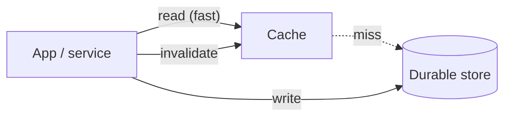

# Caching patterns

ForgeArc ships a shared application cache in Node and Python so services avoid the five mistakes that produce stale or slow systems. The cache accelerates reads. The database (or other durable store) remains the source of truth.



**Rule of thumb:** cache what is read often, changes rarely, and can be a little wrong for the configured TTL.

## Feature location

| Kit | Module |
| --- | --- |
| ForgeArc Node | `packages/shared/src/utils/cache.ts` |
| ForgeArc Python | `packages/shared/src/utils/cache.py` |
| ForgeArc AI | `packages/core/src/forgearc_ai/cache.py` |

All three expose `createCache` / `create_cache`, `CacheClient`, `MemoryCacheStore`, and `resolveCacheOptions` / `resolve_cache_options` with the same behaviour and `FORGEARC_CACHE_*` environment knobs. AI-specific guidance is in [Caching in ForgeArc AI](/ai/caching).

## Mistakes avoided

### 1. No TTL

**Mistake:** data lives forever (`Product Details v1` never expires).

**ForgeArc default:** every entry needs a positive `ttlMs`. There is no infinite default. Missing or non-positive TTL raises a configuration error.

```ts
import { createCache } from '@forgearc/shared';

const cache = createCache({ ttlMs: 60_000 }); // required
await cache.getOrLoad('product:1', () => repo.findById('1'));
```

```python
from utils.cache import create_cache

cache = create_cache(ttl_ms=60_000)
cache.get_or_load("product:1", lambda: repo.find_by_id("1"))
```

Optional **TTL jitter** (`ttlJitterRatio`, default `0.1`) spreads expiry of hot keys so they do not all miss at once.

### 2. No invalidation on write

**Mistake:** the write path updates the database and leaves the cache untouched.

**ForgeArc helper:** `writeAndInvalidate` / `write_and_invalidate` persists first, then deletes the key (and optional prefix). The next read reloads from the durable store.

```ts
await cache.writeAndInvalidate('product:1', () => repo.update(id, body), {
  alsoInvalidatePrefix: 'product:list:',
});
```

### 3. Cache stampede

**Mistake:** a hot key expires and thousands of concurrent requests hit the database together.

**ForgeArc default:** **request coalescing** (singleflight) with a per-key mutex. Concurrent `getOrLoad` callers for the same key share one loader. Configurable:

| Option | Env | Default | Role |
| --- | --- | --- | --- |
| `stampedeProtection` | `FORGEARC_CACHE_STAMPEDE_PROTECTION` | `true` | Enable singleflight mutex |
| `coalesceTimeoutMs` | `FORGEARC_CACHE_COALESCE_TIMEOUT_MS` | `5000` | Max wait for the owner loader |
| `ttlJitterRatio` | `FORGEARC_CACHE_JITTER_RATIO` | `0.1` | Spread expiries |

This matches the usual singleflight / request-coalescing pattern: one refresh, others wait (or fail open after the coalesce timeout).

### 4. Caching errors and empty results carelessly

**Mistake:** a temporary `500` or an empty result is stored and hides recovery until a long TTL ends.

**ForgeArc defaults:**

- Errors are **not** cached (`cacheErrors: false`).
- Empty / `null` results are **not** cached (`cacheNegative: false`).
- When you intentionally cache negatives, use a **short** `negativeTtlMs` (capped at 30s by default when enabled via env).

### 5. Treating the cache as the source of truth

**Mistake:** if the cache is down or empty, the system cannot serve correct data.

**ForgeArc contract:** every miss calls your loader against the durable store. Invalidation after writes forces a reload. Warm Lambda / process memory (`MemoryCacheStore`) is an accelerator only — swap in Redis or similar behind the same `CacheStore` interface when you need multi-instance sharing; durability still lives in the database.

## Configuration reference

| Setting | Env var | Default | Notes |
| --- | --- | --- | --- |
| TTL | `FORGEARC_CACHE_TTL_MS` | `60000` | Required positive ms |
| Jitter ratio | `FORGEARC_CACHE_JITTER_RATIO` | `0.1` | `0`–`1` |
| Stampede protection | `FORGEARC_CACHE_STAMPEDE_PROTECTION` | `true` | Mutex / singleflight |
| Coalesce timeout | `FORGEARC_CACHE_COALESCE_TIMEOUT_MS` | `5000` | Wait for owner loader |
| Cache empty results | `FORGEARC_CACHE_NEGATIVE` | `false` | Prefer short TTL if enabled |
| Negative TTL | `FORGEARC_CACHE_NEGATIVE_TTL_MS` | `min(ttl, 30000)` | Empty-result TTL |
| Cache errors | `FORGEARC_CACHE_ERRORS` | `false` | Keep off in production |
| Error TTL | `FORGEARC_CACHE_ERROR_TTL_MS` | `min(ttl, 5000)` | Only when errors cached |
| Key prefix | `FORGEARC_CACHE_KEY_PREFIX` | _(empty)_ | Namespace per service |

Explicit constructor options override environment values.

## Suggested service usage

1. Inject or construct one `CacheClient` per bounded context (or per module) with a key prefix.
2. Read with `getOrLoad(key, durableLoader)`.
3. On every write, call `writeAndInvalidate` (or `invalidate` / `invalidatePrefix` after your repository commit).
4. Keep TTLs aligned to how stale the data can be — not “forever”.
5. Leave stampede protection on for hot keys; leave error caching off.

## What this is not

- Not a distributed Redis client (bring your own `CacheStore` if you need cross-instance sharing).
- Not a replacement for PostgreSQL / Prisma / SQLAlchemy persistence.
- Not HTTP CDN / CloudFront edge caching (see deploy docs for static assets).

## Related

- [Request path](./request-path) — where services sit between controllers and repositories
- [Security](./security) — do not cache secrets or tokens in application caches
- [Architecture layers](./layers) — cache belongs with application helpers, not as a data layer
